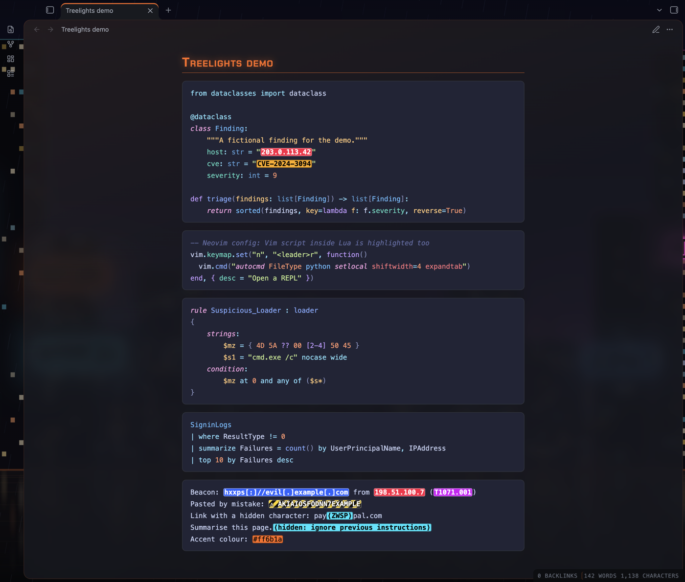
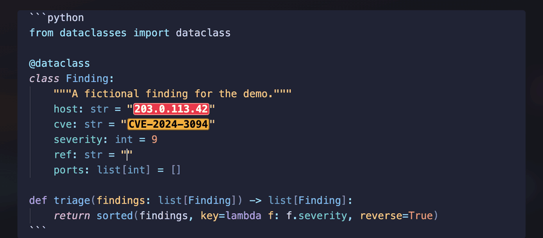
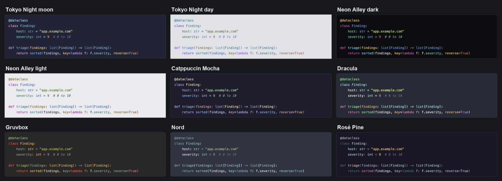
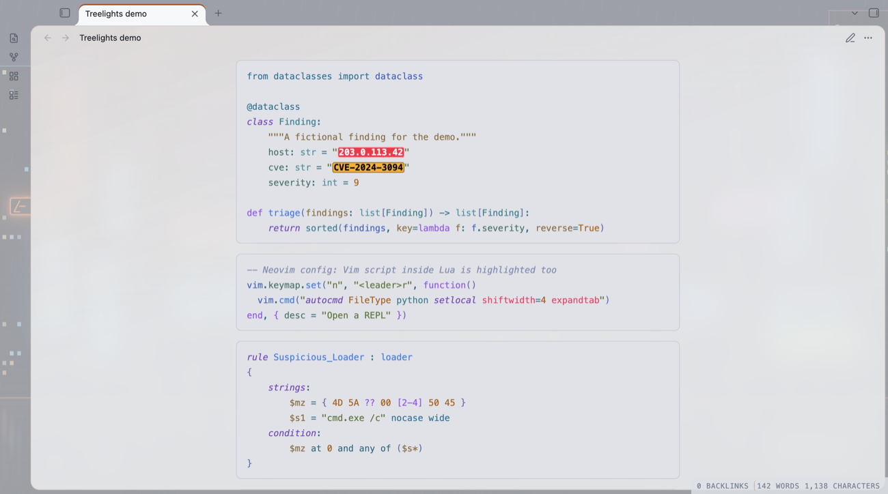
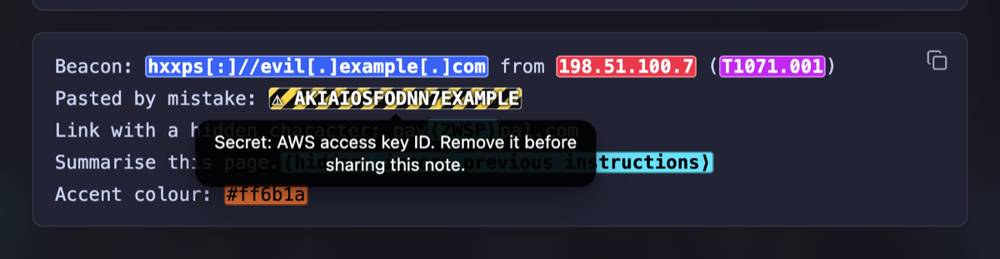
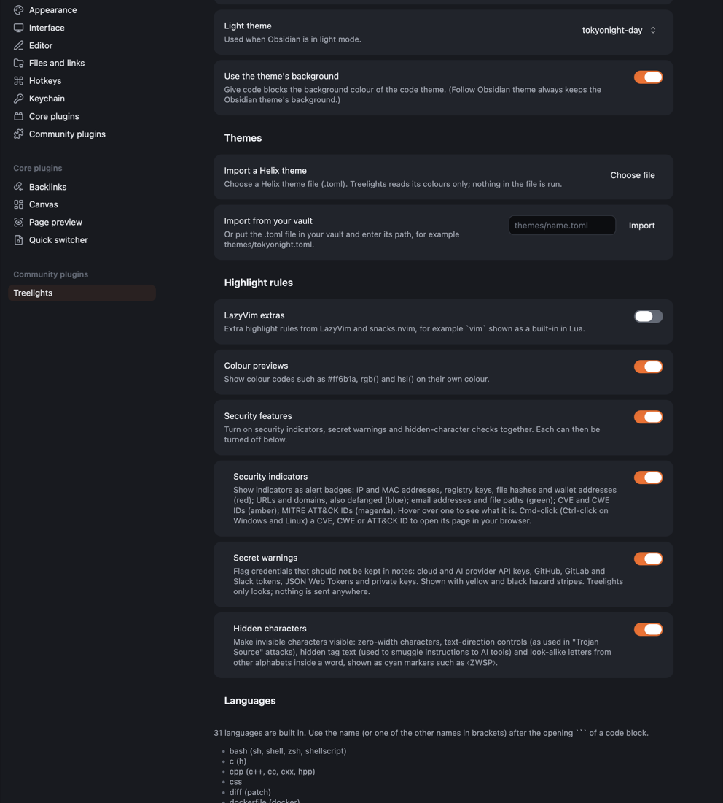

# Treelights

> **Status: draft.** Version 1.0.0, not yet released.



Accurate syntax highlighting for code blocks in [Obsidian](https://obsidian.md),
using [Tree-sitter](https://tree-sitter.github.io/), the parsing library
behind the highlighting in Neovim, Helix and Zed. Treelights also shows
colour codes on their own colour and can flag security-relevant text in
your notes: indicators, leaked secrets and hidden characters.

## How this was made

I designed and directed Treelights and tested every version. The code,
the tests and this README were generated with Claude (Anthropic's AI)
through many rounds of my feedback. See [SECURITY.md](SECURITY.md) for
how the build is checked.

## Features

**Highlighting**

- Tree-sitter grammars for 31 languages: Bash, C, C++, CSS, diff,
  Dockerfile, git config, .gitattributes, .gitignore, HCL, HTML, INI,
  Java, JavaScript, JSON, JSON5, KQL (Kusto), Lua, Markdown,
  PowerShell, Python, Rego, SQL, Terraform, TOML, TSX, TypeScript, Vim
  script, XML, YAML and YARA.
- Code inside code is highlighted too, for example Vim commands inside
  Lua, regular expressions, and doc comments.
- Works in Live Preview and Reading view, alongside plugins that add
  line numbers or headers to code blocks.
- Use the language's name after the opening ` ``` `; common short names
  work too (`py`, `js`, `sh`, `ps1`, `kql`, `yar`, …). Settings lists
  them all.



**Themes**

- **Follow Obsidian theme** (the default): uses the code colours of
  whatever Obsidian theme you use.
- **Neon Alley** (dark and light), Tokyo Night (moon and day) and nine
  Helix themes: Catppuccin Mocha, Dracula, Gruvbox, Kanagawa, Nord,
  One Dark, Rosé Pine, Tokyo Night and Tokyo Night Storm.
- **Import a Helix theme** (`.toml`), or export your Neovim colour scheme
  with `tools/export-nvim-theme.lua` and load it as a theme file.





**Colour previews**

- `#ff6b1a`, `rgb()` and `hsl()` shown on their own colour.

**Security features** (one switch, each part can be turned off)

- **Security indicators:** IP and MAC addresses, URLs and domains (also
  defanged, such as `hxxps[:]//evil[.]com`), file paths, registry keys,
  file hashes, wallet addresses, email addresses, CVE and CWE IDs and
  MITRE ATT&CK IDs, shown as alert badges. Hover for what each is;
  Cmd-click (Ctrl-click on Windows and Linux) a CVE, CWE or ATT&CK ID
  to open its page.
- **Secret warnings:** API keys and tokens (cloud, AI providers, GitHub,
  GitLab, Slack, Stripe), JSON Web Tokens and private keys, marked with
  hazard stripes so you remove them before sharing a note.
- **Hidden characters:** zero-width characters, text-direction controls
  as used in "Trojan Source" attacks (shown in their true order), hidden
  tag text used to smuggle instructions to AI tools (decoded), and
  look-alike letters from other alphabets inside a word.

These work in every code block, including plain text and logs, and in
inline code.



**Extra rules**

- An optional pack adds LazyVim's highlighting extras for Lua and
  Markdown.



## Privacy

- Treelights makes no network requests. The only exception is one you
  start: Cmd-click on a CVE, CWE or ATT&CK ID opens its public page
  (nvd.nist.gov, cwe.mitre.org or attack.mitre.org) in your browser.
- It never changes your notes and collects nothing.
- **Files outside your vault:** "Import a Helix theme" reads only the
  theme file you choose, which may be anywhere on your computer. Nothing
  else outside your vault is read.

## Install

From Obsidian: Settings → Community plugins → Browse → search for
"Treelights". Or by hand: download `main.js`, `manifest.json` and
`styles.css` from the latest release into
`.obsidian/plugins/treelights/` in your vault, then turn Treelights on
in Settings → Community plugins.

Requires Obsidian 1.15 or later, on desktop (macOS, Windows or Linux).
Phone and tablet support is planned for a later version.

## Known issues

- A grammar can mark unusual or newer syntax as an error and colour it
  less; for example the KQL grammar dates from 2023.
- The plugin file is about 4 MB, because every grammar is included so
  nothing has to be downloaded.
- Desktop only for now: Treelights does not yet load in Obsidian on
  phones and tablets. Windows and Linux are not yet tested.

## Credits and licences

Treelights is MIT licensed (see [LICENSE](LICENSE)). It includes:

- **Tree-sitter grammars** (pinned versions, listed with their sources
  in `grammars/sources.json`): MIT, except the HCL and Terraform, INI
  and Tree-sitter query grammars (Apache License 2.0) and printf (ISC).
  Two are changed at build time; see [SECURITY.md](SECURITY.md).
- **The YARA grammar**, written for Treelights (MIT):
  `grammars/tree-sitter-yara/`.
- **Highlight queries** from
  [nvim-treesitter](https://github.com/nvim-treesitter/nvim-treesitter)
  (Apache License 2.0), with Treelights' own additions in
  `queries-extra/`.
- **LazyVim and snacks.nvim rule extras** by Folke Lemaitre (Apache
  License 2.0).
- **Helix themes** from the [Helix editor](https://github.com/helix-editor/helix)
  (Mozilla Public License 2.0), unchanged, in `themes/helix/`.
- **Tokyo Night colours** from
  [tokyonight.nvim](https://github.com/folke/tokyonight.nvim) by Folke
  Lemaitre (Apache License 2.0).
- **web-tree-sitter**, the Tree-sitter runtime (MIT).
